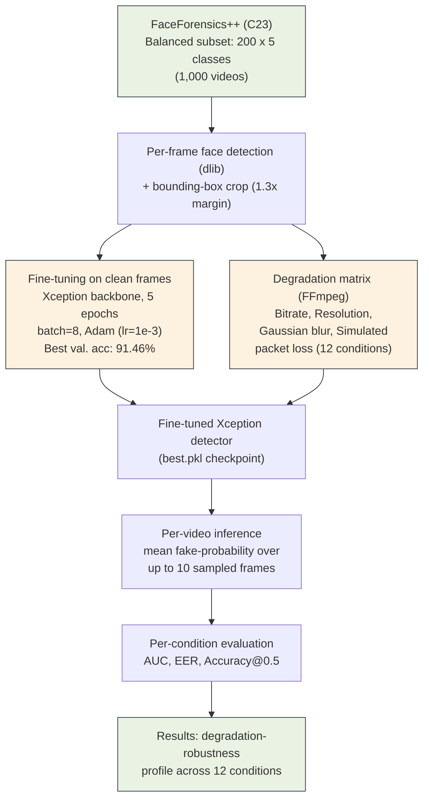

# Evaluating the Robustness of Real-Time Deepfake Detection Under Video-Conferencing Degradation

An empirical study of how a fine-tuned Xception-based deepfake detector's performance degrades under realistic video-call conditions: bitrate compression, resolution downscaling, Gaussian blur, and simulated packet loss. Built on a balanced 1,000-video subset of FaceForensics++ (C23).

**Headline finding:** compression and packet loss barely affect detection accuracy, but Gaussian blur collapses the detector's discriminative power to near-random (AUC 0.99 at baseline down to 0.59 under moderate blur), a much larger effect than resolution downscaling. See [`paper/`](./paper) for the full writeup.

## Architecture



## Results Summary

| Condition | AUC | EER | Accuracy |
|---|---|---|---|
| Baseline | 0.9997 | 0.0075 | 0.995 |
| Bitrate 500 kbps (worst) | 0.9743 | 0.0650 | 0.945 |
| Resolution 240p (worst) | 0.9207 | 0.1600 | 0.875 |
| Blur σ=1.5 | 0.9010 | 0.1975 | 0.821 |
| **Blur σ=3.0 (worst overall)** | **0.5917** | **0.4525** | 0.799 |
| Packet loss 1% | 0.9857 | 0.0550 | 0.890 |

Full results across all 12 conditions are in [`results/condition_metrics_summary.csv`](./results/condition_metrics_summary.csv).

## Repository Structure

```
 model/          # Xception architecture, training, and inference (based on HongguLiu/Deepfake-Detection)
 pipeline/        # Dataset sampling, degradation matrix, evaluation, and plotting scripts
 results/         # Metrics CSVs and manifests (no video data)
 figures/         # All plots and diagrams used in the paper
 paper/           # LaTeX source and editable architecture diagram
```

### `model/`
Forked and modified from [HongguLiu/Deepfake-Detection](https://github.com/HongguLiu/Deepfake-Detection), which implements the FaceForensics++ Xception baseline.

| File | Purpose |
|---|---|
| `detect_from_video.py` | Runs the detector on a single video, writes an annotated output video |
| `batch_infer.py` | Batch inference across many videos without writing output videos; produces per-video CSV scores |
| `extract_frames.py` | Extracts face-cropped frames from clean videos and builds train/val lists for fine-tuning |
| `train_CNN.py` | Fine-tunes the Xception backbone |
| `test_CNN.py` | Original repo's evaluation script (unused in this study, kept for completeness) |
| `network/` | Xception and MesoNet architecture definitions |
| `dataset/` | PyTorch `Dataset` class and image transforms |

### `pipeline/`

| File | Purpose |
|---|---|
| `select_subset.py` | Samples a balanced subset from a local FaceForensics++ download |
| `degrade.py` | Applies the bitrate/resolution/blur/packet-loss degradation matrix via FFmpeg |
| `analyze_results.py` | Computes AUC, EER, and accuracy per condition from inference results |
| `generate_paper_plots.py` | Regenerates every summary plot and the architecture diagram from the verified numbers below |
| `plot_blur_packetloss.py` | Standalone plot for the blur/packet-loss conditions |

## Setup

This project has two separate dependency sets: one for the detection model, one for the data pipeline.

```bash
# Model (fine-tuning and inference)
cd model
pip install -r requirements.txt
# On Windows, if dlib fails to build via pip:
# conda install -c conda-forge dlib

# Pipeline (dataset prep, degradation, analysis)
pip install pandas scikit-learn matplotlib
```

**GPU:** fine-tuning and inference were run on an NVIDIA RTX 3050 (6 GB VRAM). CUDA-enabled PyTorch is recommended but not required; CPU inference works, just much slower.

**FFmpeg:** required for `degrade.py`. Install via `winget install ffmpeg` (Windows), `apt install ffmpeg` (Linux), or `brew install ffmpeg` (macOS).

## Dataset

This repository does **not** include any FaceForensics++ video data or the fine-tuned model checkpoint, since:
- FaceForensics++ is gated behind a non-redistribution agreement with the Technical University of Munich. Request access at [github.com/ondyari/FaceForensics](https://github.com/ondyari/FaceForensics).
- The fine-tuned checkpoint is derived from that restricted data.

Once you have FaceForensics++ (C23) downloaded locally, reproduce the pipeline with:

```bash
python pipeline/select_subset.py --dataset_root <path> --output_dir ./subset --per_class 200
python pipeline/degrade.py --manifest ./subset/subset_manifest.csv --output_dir ./degraded --workers 6
python model/extract_frames.py --subset_manifest ./subset/subset_manifest.csv --output_dir ./frames
python model/train_CNN.py -n my_finetune -tl ./data_list/my_train.txt -vl ./data_list/my_val.txt -bz 8 -e 5 --continue_train True -mp <pretrained_checkpoint>
python model/batch_infer.py --degradation_manifest ./degraded/degradation_manifest.csv --model_path ./output/my_finetune/best.pkl --output_csv ./inference_results.csv --max_frames 10 --cuda
python pipeline/analyze_results.py --results_csv ./inference_results.csv --output_dir ./analysis
```

## Paper

The full research paper (currently preprint / pending publication) can be viewed directly on Overleaf:
- 📄 **[Read Manuscript on Overleaf](https://www.overleaf.com/read/ryxqhmcfqvhn#31fb50)**

The full LaTeX source, including related work, methodology, and discussion, is provided in [`paper/deepfake_robustness_paper.tex`](./paper/deepfake_robustness_paper.tex) (IEEE conference format, compiles cleanly on Overleaf). The architecture diagram is also available as an editable [`architecture_diagram.drawio`](./paper/architecture_diagram.drawio) file.

## Authors

- Ghodake Naman Nitin (24BCE5051)
- Ekansh Dhanotiya (24BCE5127)
- Aditya Gautam (24BCE5316)

SCOPE, Vellore Institute of Technology, Chennai

## License

The `model/` directory retains the license of the original [HongguLiu/Deepfake-Detection](https://github.com/HongguLiu/Deepfake-Detection) repository it is based on. See `model/LICENSE`.
